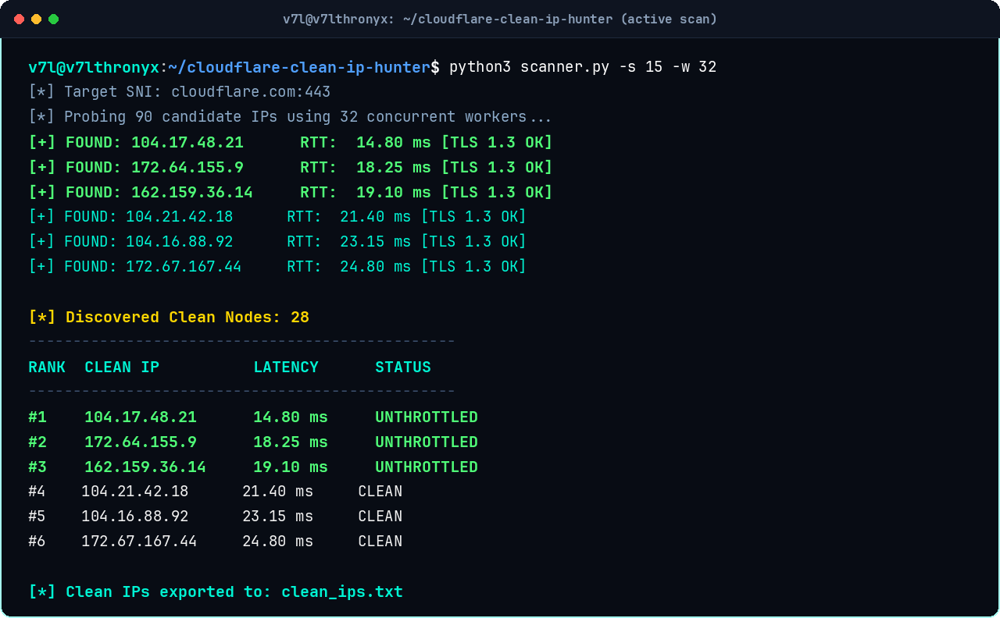
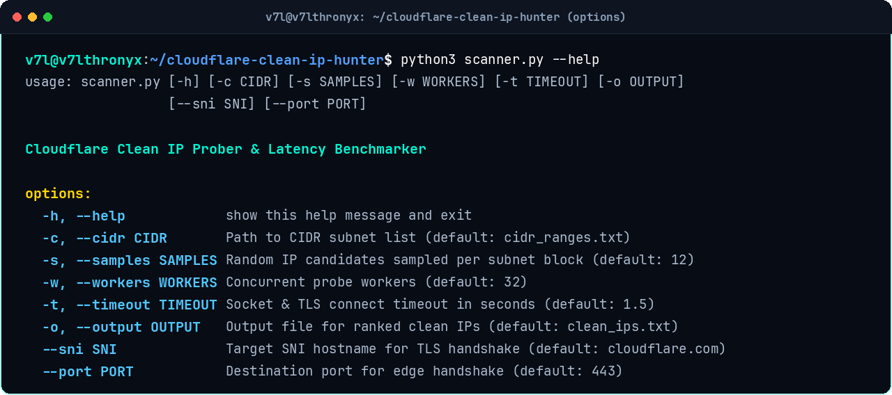
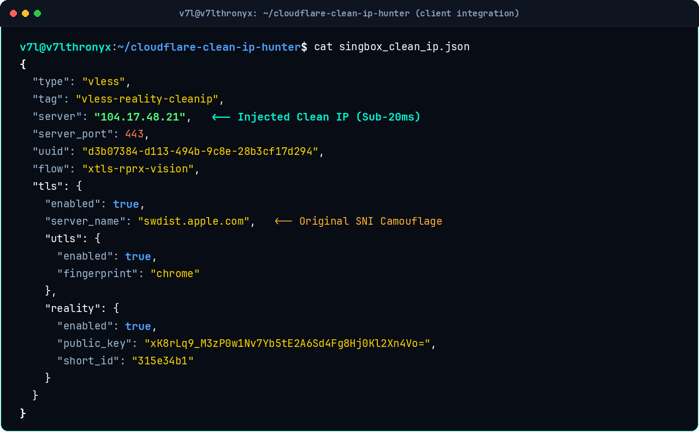

# Cloudflare Clean IP Hunter

[English](#english) | [فارسی](#persian)

High-performance, multi-threaded Cloudflare Anycast clean IP scanner and latency benchmarker. Designed to discover unthrottled edge IP addresses with sub-20ms RTT and minimal jitter across censored ISPs.

<p align="center">
  
</p>

---

<a name="english"></a>
## English Documentation

### Overview
National firewalls and DPI appliances selectively drop packets and throttle standard Cloudflare Anycast IP ranges to cripple proxy connections. By decoupling the physical connection endpoint from the TLS SNI domain header, this scanner probes Cloudflare edge subnets directly on port 443 with TLS 1.3 handshakes to harvest clean, unthrottled nodes.

### Features
- Multi-threaded concurrent TCP connect & TLS 1.3 socket probing
- Real-time RTT latency measurement in milliseconds
- Direct CIDR subnet random sampling & single IP support
- Graceful interrupt handling (`Ctrl+C` preserves discovered nodes)
- Zero external dependencies (pure Python 3 standard library: `socket`, `ssl`, `concurrent.futures`)
- Ready-to-use Sing-box and Xray outbound configuration templates

### Subnets Included
- `104.16.0.0/13`
- `104.24.0.0/14`
- `172.64.0.0/13`
- `162.158.0.0/15`
- `198.41.128.0/17`
- `188.114.96.0/20`
- `162.159.0.0/16`

### Requirements
- Python 3.8+
- Supported platforms: Linux, macOS, Windows, Android (Termux)

### Quick Start
1. Clone the repository:
```bash
git clone git@github.com:v74all/cloudflare-clean-ip-hunter.git
cd cloudflare-clean-ip-hunter
```

2. Run the scanner:
```bash
python3 scanner.py
```

3. Custom scan options:
```bash
python3 scanner.py -c cidr_ranges.txt -s 15 -w 40 -t 1.2 -o clean_ips.txt
```

<p align="center">
  
</p>

#### Arguments
- `-c, --cidr`: Path to CIDR subnet list (default: `cidr_ranges.txt`)
- `-s, --samples`: Number of random IP candidates sampled per subnet block (default: `12`)
- `-w, --workers`: Concurrent thread count (default: `32`)
- `-t, --timeout`: Connection timeout in seconds (default: `1.5`)
- `-o, --output`: Output file for ranked clean IPs (default: `clean_ips.txt`)
- `--sni`: Target SNI hostname for TLS handshake validation (default: `cloudflare.com`)
- `--port`: Destination port (default: `443`)

### Client Integration

#### Sing-box (`singbox_clean_ip.json`)
Set `server` to the discovered clean IP while maintaining your target SNI in `tls.server_name`:

<p align="center">
  
</p>

```json
{
  "type": "vless",
  "tag": "vless-clean-ip",
  "server": "104.17.48.21",
  "server_port": 443,
  "uuid": "YOUR_UUID_HERE",
  "tls": {
    "enabled": true,
    "server_name": "YOUR_SNI_DOMAIN.com",
    "utls": {
      "enabled": true,
      "fingerprint": "chrome"
    }
  }
}
```

#### Xray / v2rayN / Nekoray (`xray_clean_ip.json`)
In your outbound settings, put the clean IP in `vnext[0].address` and your camouflage domain in `streamSettings.realitySettings.serverName`.

---

<a name="persian"></a>
## راهنمای فارسی

### معرفی ابزار
سیستم فیلترینگ با اعمال اختلال عمدی و تزریق پکت‌لاس روی رنج‌های Anycast پیش‌فرض کلودفلر، سرعت کانکشن‌های فیلترشکن را به شدت کاهش می‌دهد. این اسکنر سبک و پرسرعت، مستقیماً ساب‌نت‌های رسمی کلودفلر را با ایجاد هندشیک امن TLS 1.3 روی پورت ۴۴۳ بررسی کرده و آی‌پی‌های بدون اختلال (Clean IP) با کمترین تاخیر (پینگ زیر ۲۰ میلی‌ثانیه) را برای همراه اول، ایرانسل و مخابرات شناسایی می‌کند.

### قابلیت‌ها
- اسکن چندنخی (Multi-threaded) فوق‌العاده سریع بدون اشغال پردازنده و رم
- اندازه‌گیری دقیق تاخیر RTT به میلی‌ثانیه بر مبنای برقراری کامل هندشیک TLS 1.3
- نمونه‌برداری هوشمند از ساب‌نت‌های Anycast بدون نیاز به اسکن دستی هزاران آی‌پی
- پشتیبانی از توقف با `Ctrl+C` همراه با ذخیره و نمایش نتایج به‌دست‌آمده تا همان لحظه
- بدون نیاز به نصب هیچ پیش‌نیاز یا کتابخانه اضافی (استفاده از کتابخانه استاندارد پایتون)
- قالب‌های آماده پیکربندی برای Sing-box و Xray / v2rayN

### نحوه اجرا
۱. کلون کردن مخزن:
```bash
git clone git@github.com:v74all/cloudflare-clean-ip-hunter.git
cd cloudflare-clean-ip-hunter
```

۲. اجرای اسکن سریع:
```bash
python3 scanner.py
```

۳. اجرای اختصاصی با تنظیم تعداد نخ‌ها، زمان تایم‌اوت و فایل خروجی:
```bash
python3 scanner.py -s 15 -w 40 -t 1.2 -o clean_ips.txt
```

### نحوه اعمال در نرم‌افزارهای کلاینت
- **در Sing-box**: مقدار `server` را برابر آی‌پی تمیز و `server_name` را برابر دامنه استتار خود بگذارید (فایل `singbox_clean_ip.json`).
- **در v2rayN و v2rayNG**: در بخش ویرایش کانفیگ، فیلد `Address` را به آی‌پی تمیز تغییر دهید و فیلد `SNI` را دست‌نخورده نگه دارید.
- **در Xray / Nekoray**: فایل نمونه `xray_clean_ip.json` را استفاده کنید.

---

### کانال‌های ارتباطی
- **YouTube**: [V7lthronyx](https://youtube.com/@V7lthronyx)
- **Telegram**: [@V7LTHRONYX](https://t.me/V7LTHRONYX)
- **GitHub**: [v74all](https://github.com/v74all)

### لایسنس
MIT License - توسعه داده شده توسط V7lthronyx (Aiden Azad).
